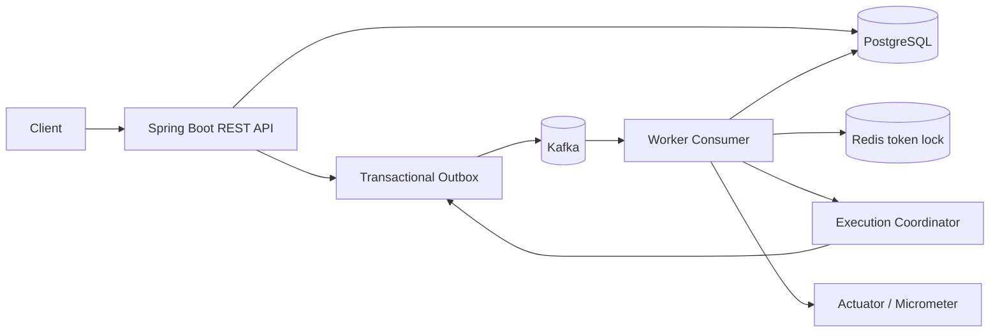

# FlowForge — Distributed Workflow & Job Execution Engine

FlowForge is a backend systems project that executes dependency graphs (DAGs) of jobs with asynchronous workers, durable event publishing, retries, and observability. It is designed as a portfolio-grade engineering project: the README documents the architecture and known trade-offs rather than claiming production certification.

## Architecture



- **Java 17 + Spring Boot 3** REST API and worker.
- **PostgreSQL + Spring Data JPA** workflow, job, dependency, execution, and outbox persistence.
- **DAG validation** using Kahn's topological-sort algorithm; cycles are rejected before a run starts.
- **Kafka** asynchronous job dispatch and worker consumption.
- **Transactional outbox** separates database writes from event publishing.
- **Redis** token-based worker locks. Retry timing is stored in PostgreSQL outbox rows, so Redis is not the source of truth for retry delivery.
- **Retry + DLQ** exponential retry delay persisted with the job state and outbox event in one database transaction; exhausted jobs are published to a dead-letter topic through the same outbox.
- **Crash recovery** periodic heartbeat sweep for stale RUNNING jobs.
- **Micrometer / Spring Actuator** health and Prometheus metrics.
- **Static dashboard** served by Spring Boot at `/`.

## Run locally (Docker)

Prerequisites: Docker Desktop with Compose v2. From the project directory:

```bash
docker compose up --build -d
docker compose ps
docker compose logs -f app
```

Open:
- Dashboard: http://localhost:8081/
- Health: http://localhost:8081/actuator/health
- Prometheus metrics: http://localhost:8081/actuator/prometheus
- Swagger UI: http://localhost:8081/swagger-ui/index.html (if enabled in the build)
- Workflows API: http://localhost:8081/api/workflows

To stop: `docker compose down`. To remove local database/Redis data too: `docker compose down -v` (destructive).

Default credentials are **for local development only**. Copy `.env.example` to `.env` and change `POSTGRES_PASSWORD` before sharing/deploying. Do not expose these ports publicly.

## Quick API walkthrough

The database initializer creates a sample four-node workflow when the workflow table is empty. List workflows first; use the returned ID rather than assuming it is `1`.

```bash
curl http://localhost:8081/api/workflows
```

Create a workflow and jobs (job type is one of `LOG`, `COMPUTE`, `TRANSFORM`, `HTTP_DISPATCH`):

```bash
curl -X POST http://localhost:8081/api/workflows ^
  -H "Content-Type: application/json" ^
  -d "{\"name\":\"Demo pipeline\"}"

curl -X POST http://localhost:8081/api/jobs ^
  -H "Content-Type: application/json" ^
  -d "{\"workflowId\":2,\"name\":\"ingest\",\"type\":\"LOG\",\"payload\":\"seed\"}"
```

A dependency is expressed as `jobId` depends on `dependsOnJobId` (the child waits for the parent):

```bash
curl -X POST http://localhost:8081/api/dependencies ^
  -H "Content-Type: application/json" ^
  -d "{\"jobId\":4,\"dependsOnJobId\":3}"
```

Trigger and inspect a run:

```bash
curl -X POST http://localhost:8081/api/executions/trigger/1
curl http://localhost:8081/api/executions/1/status
```

The examples use Windows CMD line continuation. In PowerShell, `curl` may alias `Invoke-WebRequest`; use `curl.exe` or run the requests on one line. Replace IDs with IDs returned by your API calls.

## API endpoints

| Method | Endpoint | Purpose |
|---|---|---|
| `GET` | `/api/workflows` | List workflows |
| `POST` | `/api/workflows` | Create workflow: `{"name":"..."}` |
| `GET` | `/api/workflows/{id}/jobs` | List jobs in a workflow |
| `POST` | `/api/jobs` | Create a job |
| `POST` | `/api/dependencies` | Add a dependency edge |
| `POST` | `/api/executions/trigger/{workflowId}` | Validate and trigger a workflow |
| `GET` | `/api/executions/{executionId}/status` | Inspect job execution states |
| `GET` | `/actuator/health` | Service health |
| `GET` | `/actuator/prometheus` | Metrics scrape endpoint |

## Engineering notes / limitations

This repository is a strong systems-oriented portfolio foundation, but **a Docker build and end-to-end run must pass in your environment before claiming it is production-ready**. At-least-once delivery is the practical model: workers should remain idempotent because events may be delivered more than once. The sample task handlers are simulations, not a sandbox for arbitrary user code. The heartbeat sweeper and outbox publisher need load/failure testing before production use; a production deployment should add authentication/authorization, request validation, schema migrations (Flyway/Liquibase), structured logging, distributed tracing, integration tests with Testcontainers, and a secured secrets strategy. The outbox intentionally provides at-least-once publication, not exactly-once external side effects.

## Suggested portfolio demo

1. Start the stack and show `/actuator/health`.
2. Trigger the sample ETL DAG.
3. Show the parallel B/C branches waiting on A, then D waiting for both branches.
4. Show the execution status endpoint and Prometheus counters.
5. Explain the transactional outbox, retry/backoff, idempotency, and the trade-offs of distributed locks.

## Resume bullet (only after verifying locally)

Built **FlowForge**, a distributed DAG workflow engine using Java 17, Spring Boot, PostgreSQL, Kafka, and Redis, implementing cycle validation, asynchronous job dispatch, transactional outbox publishing, retry/DLQ handling, worker-heartbeat recovery, and Micrometer observability.
